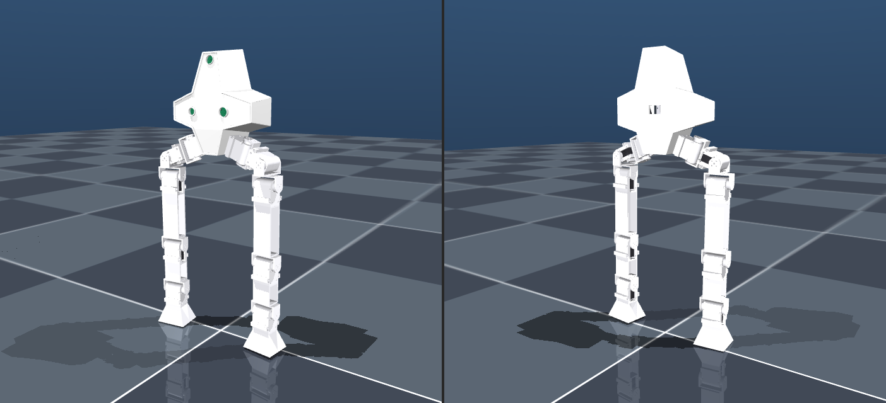

# Nomios

A low-cost (~£700), 10-DoF autonomous bipedal robot designed for rough-terrain forest floor exploration and biodiversity monitoring.



## Project Goal

Standard wheeled platforms tend to hang up on exposed roots, thick leaf litter, and uneven forest undergrowth, while dense tree canopies make GPS unreliable. Nomios is being developed as a compact (~63 cm tall, 1.41 kg) bipedal platform able to step over small floor obstacles while carrying edge perception for ecological surveying:

- **Botanical classification:** Using onboard stereo and head-mounted 8 MP RGB cameras to spot and classify undergrowth flora, fungi, and invasive species.
- **Bioacoustic monitoring:** Sampling ambient audio via an onboard USB microphone to detect bird and amphibian calls.
- **Local spatial logging:** Recording detections alongside local odometry coordinates without relying on GPS or cloud connectivity.

## Current Status

This repository currently covers the mechanical design, CAD-to-simulation tooling, and MuJoCo digital twin:

- [x] **SolidWorks mechanical CAD** — 10-DoF bipedal leg assembly, custom STS3215 clamshell housings and U-brackets, 80 mm stereo camera mount, and electronics torso shell (`parts/`).
- [x] **Direct SolidWorks-to-URDF/MJCF pipeline** — Python parser (`scripts/build_model.py`) that reads `.SLDASM` / `.SLDPRT` binary streams directly to extract tessellations, joint pivots, shaft axes, camera extrinsics, inertias, and foot sole colliders without requiring a SolidWorks runtime license.
- [x] **MuJoCo digital twin & validation suite** — Position-controlled 10-actuator model with 9-DoF IMU, bilateral foot contact sensors, and 3 onboard camera views (`models/`, `urdf/`, `tests/`).
- [ ] **Locomotion control & RL policy** — Training and validating standing balance and rough-terrain walking policies in simulation.
- [ ] **Onboard perception & audio pipeline** — Stereo traversability mapping, plant classification, and bioacoustic event logging.
- [ ] **Physical build & sim-to-real transfer** — 3D printing the PETG frame, wiring the Arduino Uno Q + STS3215 servo bus, and deploying closed-loop control on hardware.

## Key Specifications

| Parameter | Value |
| :--- | :--- |
| Dimensions (standing) | ~0.63 m H x 0.33 m W x 0.09 m D |
| Modeled mass | 1.41 kg (torso: 0.48 kg, each leg: 0.46 kg) |
| Degrees of freedom | 10 actuated (5 per leg: hip yaw, hip roll, hip pitch, knee pitch, ankle pitch) |
| Actuators | 10x Feetech STS3215 serial bus servos (2.94 N·m stall @ 7.4 V) |
| Compute | Arduino Uno Q 4GB |
| Vision & sensing | 3x Raspberry Pi Camera v2 8 MP (80 mm stereo pair + top camera), BNO085 9-DoF IMU, USB mic |
| Power | 2S LiPo (7.4 V) direct servo bus + 5 V / 5 A UBEC logic supply |
| Frame | 3D-printed PETG with M3 heat-set inserts and F623ZZ flanged bearings |
| Target BOM budget | ~£700 |

See [docs/hardware.md](docs/hardware.md) for the bill of materials, joint kinematics table, and power/wiring architecture.

## Repository Structure

```text
nomios/
├── docs/
│   ├── hardware.md            # BOM, kinematics, power/wiring diagram, CAD notes
│   └── images/
│       └── nomios_render.png  # MuJoCo digital twin renders
├── meshes/                    # 56 binary STL meshes extracted from SolidWorks
├── models/
│   ├── scene.xml              # MuJoCo environment (lights, floor, cameras)
│   └── system.xml             # Robot kinematic tree, actuators, and sensors
├── parts/                     # SolidWorks .SLDASM / .SLDPRT / .STEP CAD files
│   ├── sts3215_housing/       # Clamshell servo mounts and U-brackets
│   └── v1/                    # Early leg link iterations
├── scripts/
│   ├── build_model.py         # SolidWorks -> STL, URDF, and MJCF generator
│   ├── scene_gen.py           # MuJoCo scene XML generator
│   └── sld_io.py              # SolidWorks stream unpacker and binary STL I/O
├── tests/
│   └── test_model.py          # Compilation, structure, camera, and sensor tests
├── urdf/
│   └── nomios.urdf            # Generated 10-DoF URDF
├── main.py                    # MuJoCo viewer entry point
└── pyproject.toml             # Python dependencies and package config
```

## Getting Started

### Prerequisites

- Python 3.10+
- OpenGL-capable environment for the MuJoCo interactive viewer

### Setup

```bash
git clone https://github.com/teddyprendergast-pixel/nomios.git
cd nomios
python -m venv .venv
source .venv/bin/activate  # Windows: .venv\Scripts\activate
pip install -e .
```

### View the Digital Twin

Launch the MuJoCo passive viewer:

```bash
python main.py
```

Or open the full interactive MuJoCo GUI (camera presets, joint sliders, perturbation forces):

```bash
python main.py --interactive
```

### Rebuild Meshes, URDF, and MJCF from SolidWorks CAD

```bash
python scripts/build_model.py
```

This reads `parts/full assembly.SLDASM` and its referenced `.SLDPRT` parts, writes the 56 link-local meshes to `meshes/`, and regenerates `urdf/nomios.urdf`, `models/system.xml`, and `models/scene.xml`.

### Run Validation Tests

```bash
python -m unittest discover -s tests -v
```

## License

Released under the [MIT License](LICENSE).
